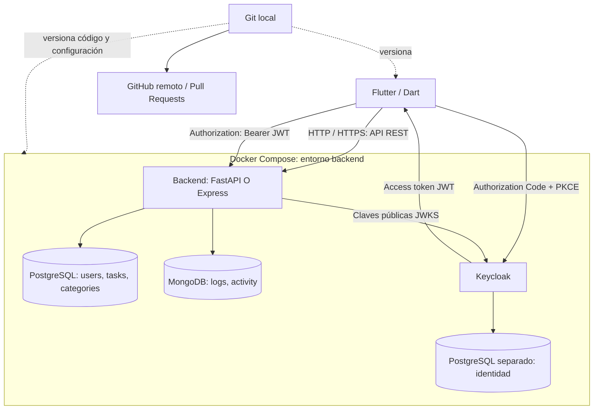
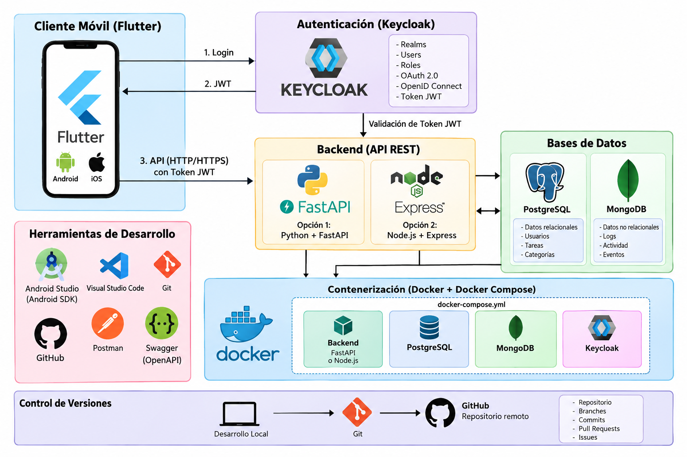

# 06. Arquitectura del entorno

*Vista general de la arquitectura DevOps: Flutter, backend, PostgreSQL, MongoDB, Keycloak, Docker y Git.*

FastAPI y Express implementan el mismo contrato; elige una alternativa. Keycloak mantiene su propia base de identidad y credenciales, separada de las tablas de aplicación. No se conectan PostgreSQL o MongoDB directamente desde Flutter.

En el laboratorio HTTP facilita la configuración local; en producción se utiliza HTTPS. El backend usa nombres de servicio (`postgres`, `mongo`, `keycloak`) dentro de Docker. Un teléfono necesita una dirección accesible desde su red o el puente USB descrito en el capítulo 32.

La escritura de tareas y la auditoría en MongoDB no forman una transacción distribuida. Si falla MongoDB después de guardar una tarea, la respuesta indica `audit_recorded: false`; el capítulo 39 explica esta limitación deliberada.
