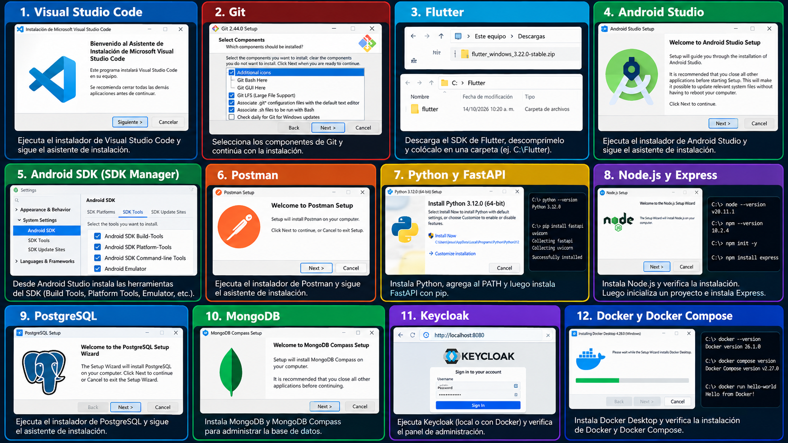

# 08. Software necesario

| Herramienta | Función | Obligatoria/Opcional |
| --- | --- | --- |
| VS Code | Edición y depuración | Recomendado; otro IDE es posible |
| Git | Historial local | Obligatoria |
| GitHub | Repositorio remoto y revisión | Obligatoria para la entrega |
| Flutter | SDK de aplicación móvil | Obligatoria |
| Dart | Lenguaje, incluido con Flutter | Obligatoria; sin instalación separada |
| Android Studio | SDK Manager y emulador | Obligatoria en esta ruta |
| Android SDK | Compilación y conexión Android | Obligatoria |
| Postman | Pruebas de API | Obligatoria |
| Docker Desktop | Motor Linux y Compose en Windows | Obligatoria en esta ruta |
| Docker Compose | Servicios coordinados | Obligatoria; incluida en Desktop |
| PostgreSQL | Datos relacionales | Obligatoria, instalada como contenedor |
| MongoDB | Actividad y registros | Obligatoria, instalada como contenedor |
| Python | Runtime de FastAPI | Alternativa A; local opcional con Docker |
| FastAPI | API Python | Alternativa A |
| Node.js y npm | Runtime y dependencias JavaScript | Alternativa B; local opcional con Docker |
| Express | API JavaScript | Alternativa B |
| Keycloak | Identidad y login | Obligatoria, como contenedor |
| Swagger UI / OpenAPI | Interfaz y contrato de API | Incluidos con los backends |
| MongoDB Compass | Exploración gráfica | Opcional |
| Cliente PostgreSQL | Consultas SQL | `psql` incluido en el contenedor |

No instales servidores nativos de PostgreSQL o MongoDB si seguirás la ruta Docker: podrían ocupar los mismos puertos. Sí puedes utilizar sus clientes gráficos desde Windows.

*Resumen visual de las herramientas de desarrollo que se instalan en esta ruta.*
