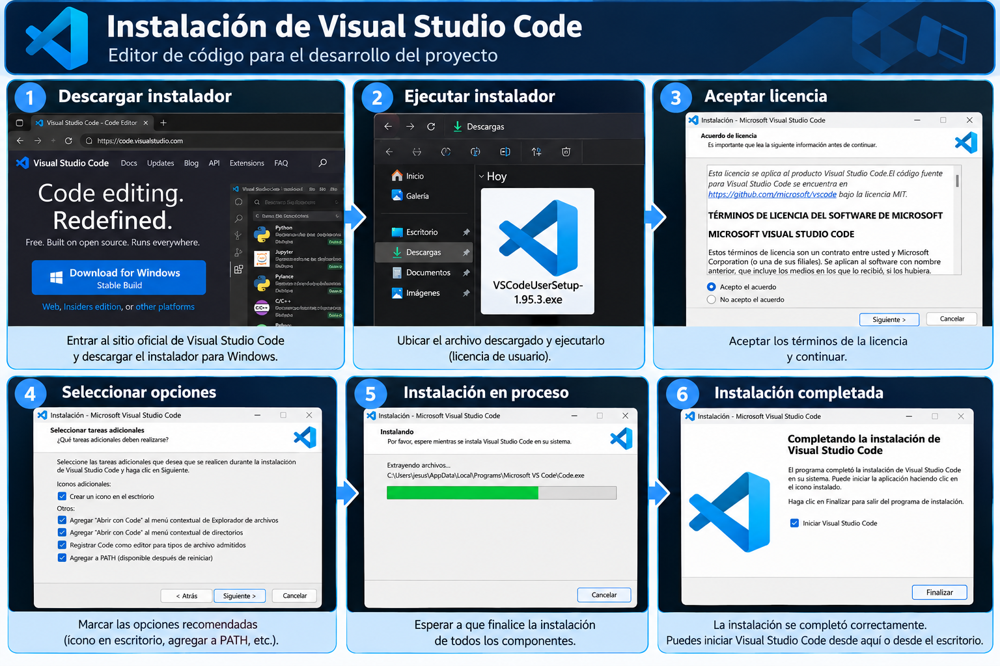
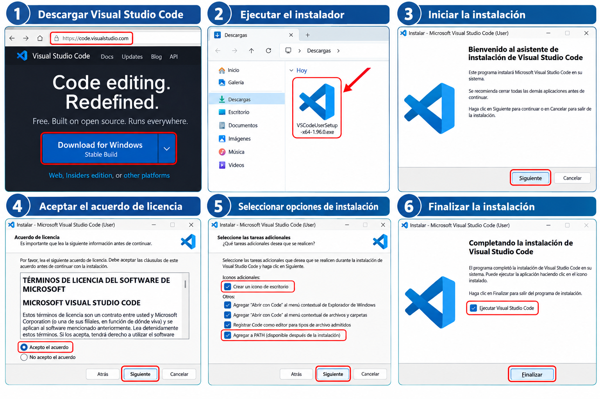
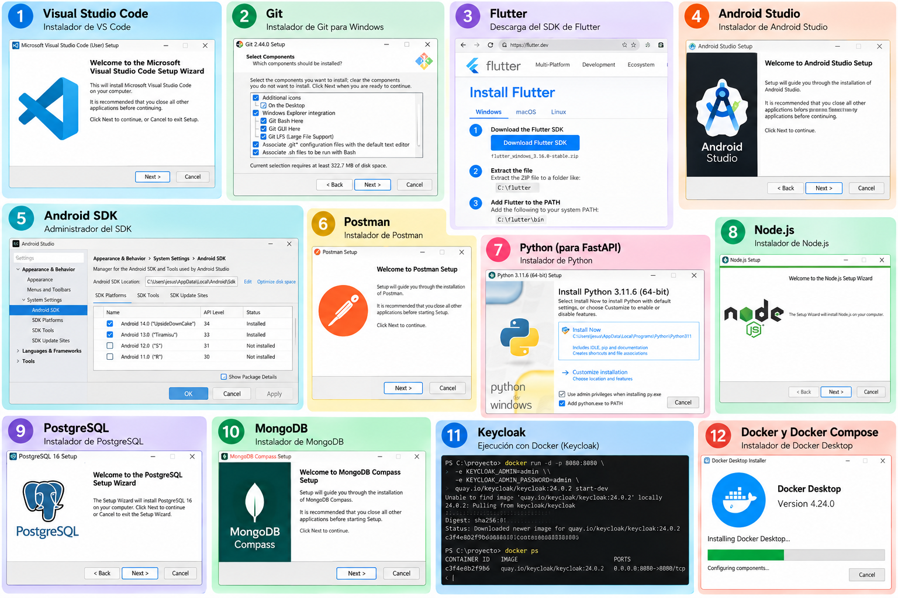
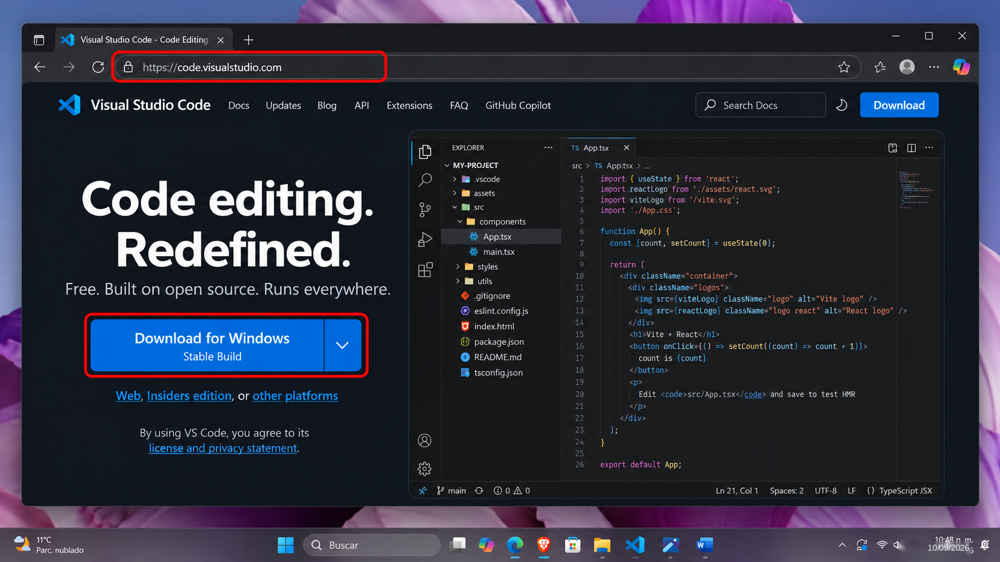
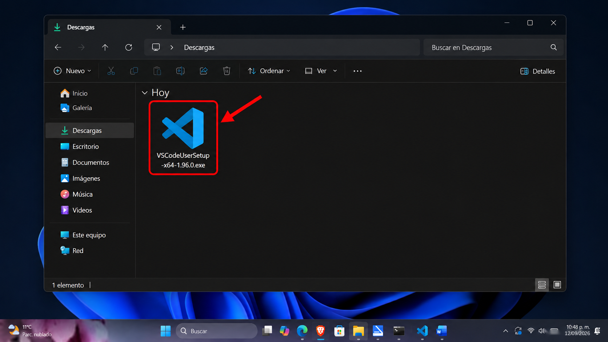
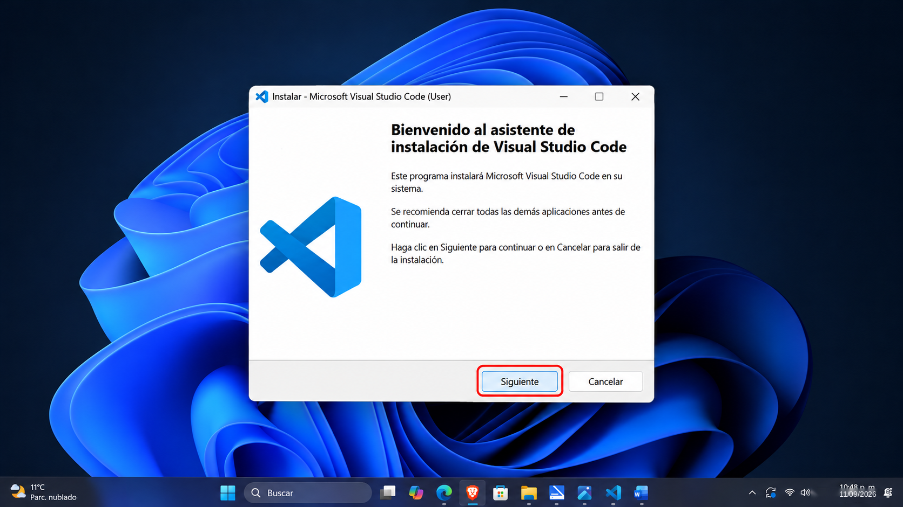
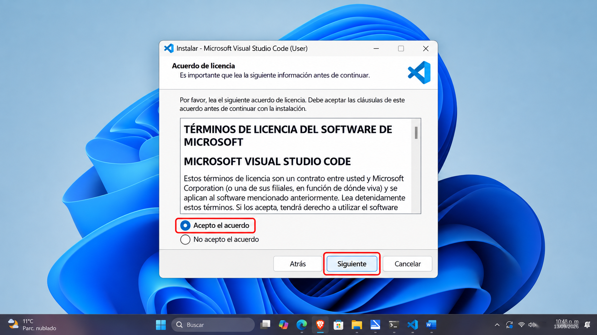
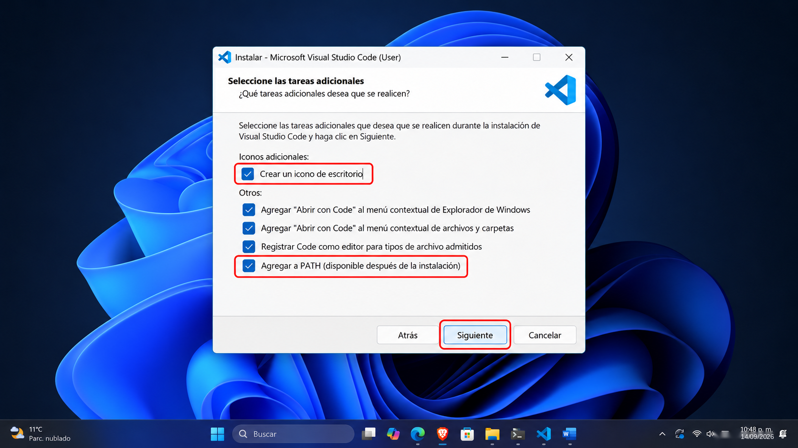
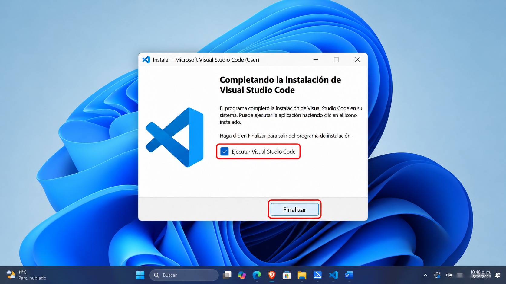

# 10. Visual Studio Code

## ¿Qué es y para qué sirve?

Editor extensible que reúne archivos, terminal y depurador. Resuelve el trabajo disperso entre ventanas, pero no instala por sí mismo los SDK del proyecto.

## Papel dentro de la arquitectura y requisitos

Herramienta de desarrollo, no servicio en producción. Requiere Windows compatible e Internet para extensiones.

## Instalación y configuración

Instala desde [VS Code](https://code.visualstudio.com/docs/setup/windows), abre `proyecto-movil` con **File → Open Folder** y usa **Terminal → New Terminal**. Selecciona PowerShell. En extensiones instala según el módulo:



*Descarga e instalación de Visual Studio Code.*

| Extensión | Publicador a comprobar | Uso |
| --- | --- | --- |
| Flutter y Dart | Dart Code | Análisis, depuración y dispositivos |
| Python | Microsoft | Intérprete y pruebas Python |
| Docker / Container Tools | Microsoft | Imágenes y contenedores |
| GitHub Pull Requests | GitHub | Revisar PR e Issues |
| PostgreSQL | Microsoft u otro publicador verificado | Consultas SQL; opcional |
| MongoDB for VS Code | MongoDB | Documentos y consultas |

Los nombres del catálogo pueden cambiar: revisa publicador y permisos antes de instalar. Elige `.venv` como intérprete Python y la carpeta del Flutter SDK cuando el editor lo solicite.



*Visual Studio Code abierto en Windows con el proyecto cargado.*



*Zona de archivos, editor, terminal integrada y panel de extensiones.*

## Guía visual de instalación



*Paso 1. Página de descarga de Visual Studio Code para Windows.*



*Paso 2. Localiza el instalador descargado en la carpeta Descargas.*



*Paso 3. Abre el asistente de instalación y pulsa Siguiente.*



*Paso 4. Revisa y acepta el acuerdo de licencia para continuar.*



*Paso 5. Selecciona las tareas adicionales, incluido agregar VS Code al PATH.*



*Paso 6. Finaliza la instalación y abre Visual Studio Code.*

## Comandos principales y ejemplo práctico

Desde `proyecto-movil`:

```powershell
code .
```

Abre un archivo Markdown y su vista previa con `Ctrl + Shift + V`. Para Flutter usa **Flutter: Select Device** en la paleta y `F5`.

## Verificación, errores comunes y soluciones

Si `code` no se reconoce, abre la carpeta desde el menú y revisa la opción PATH del instalador. Si faltan sugerencias de Dart, abre la carpeta con `pubspec.yaml` y comprueba la extensión.

## Evidencia y conclusión

**E16:** editor, extensiones e intérprete seleccionados. Concluye qué SDK utiliza cada extensión. [Referencia Flutter en VS Code](https://docs.flutter.dev/tools/vs-code).
