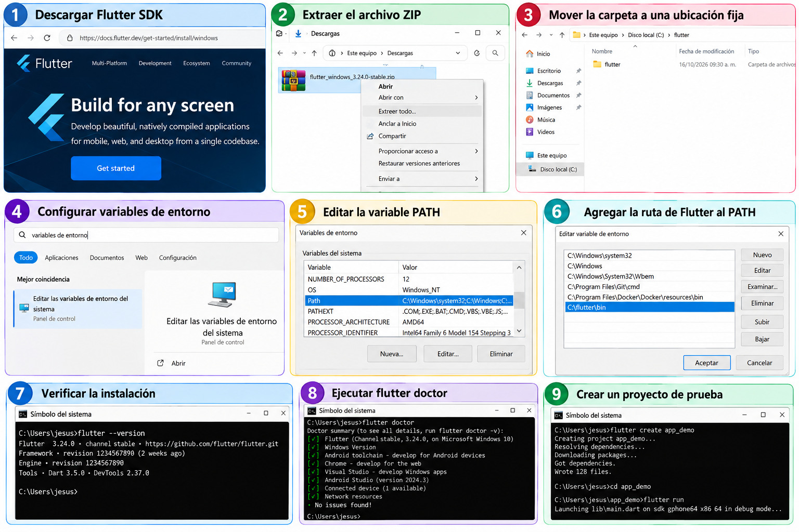
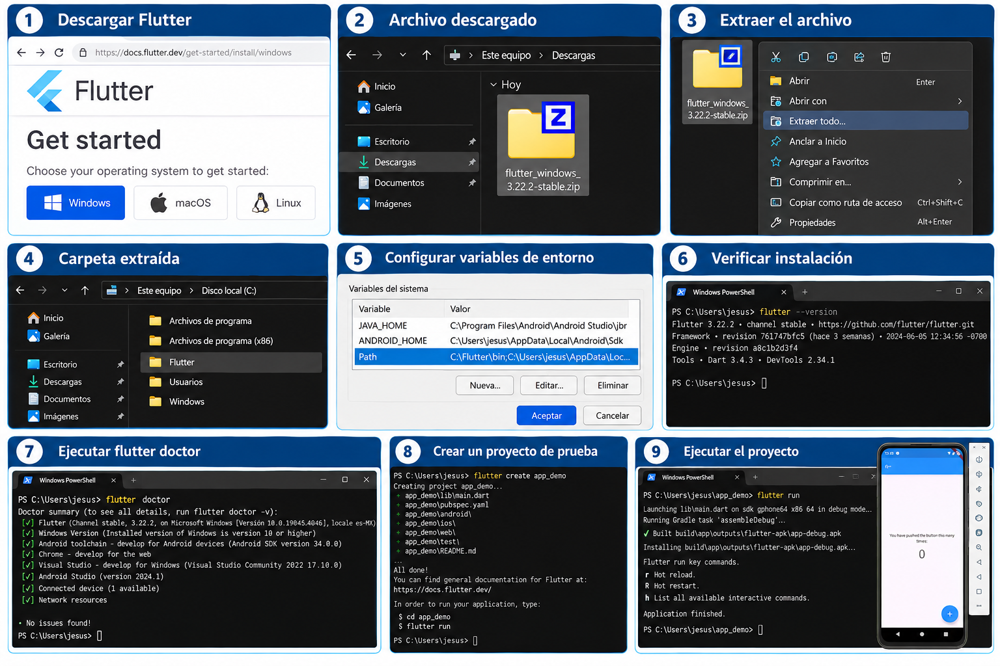
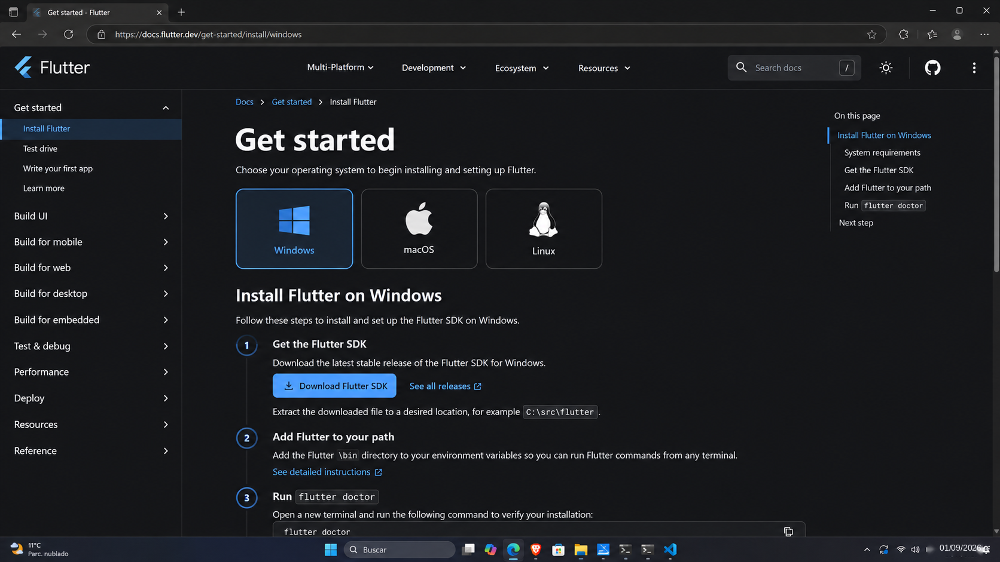
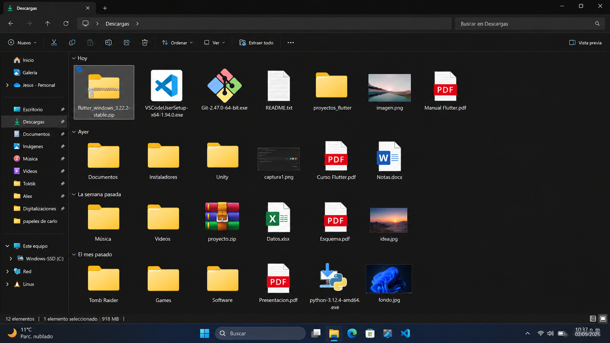
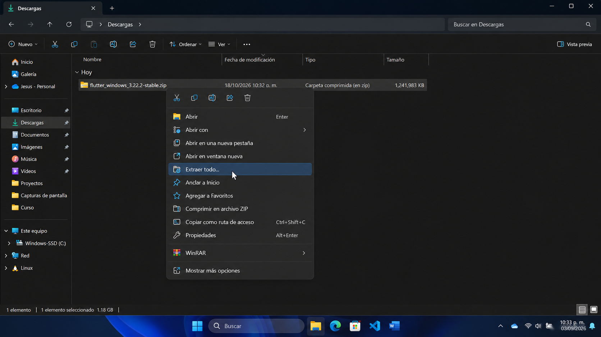
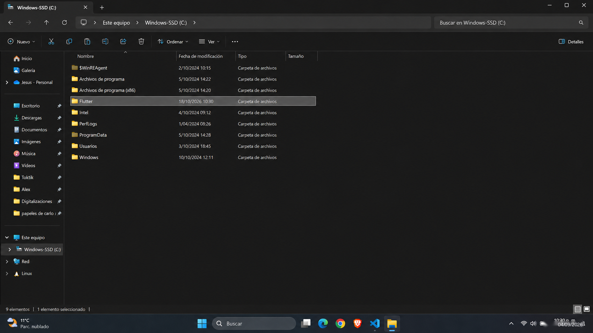
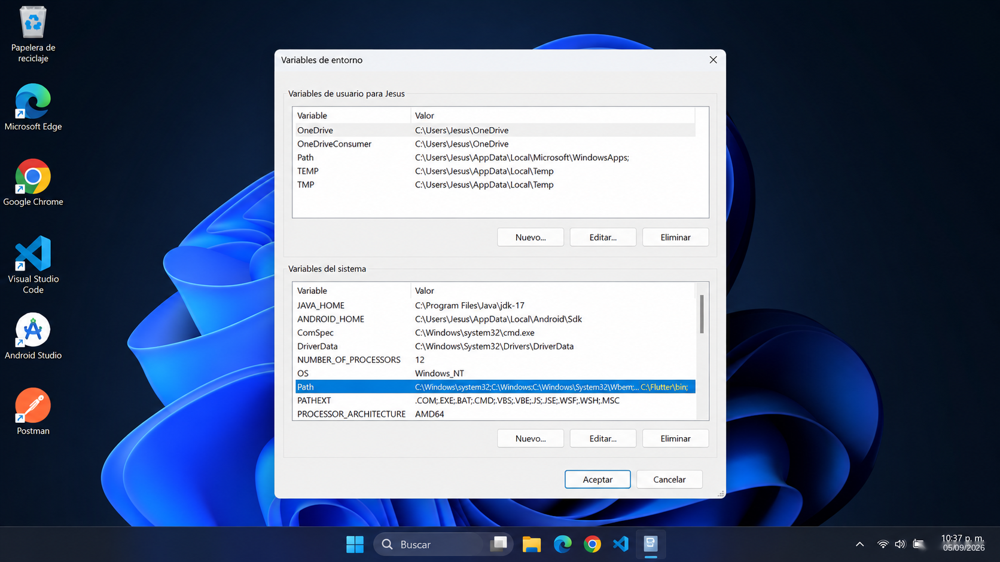
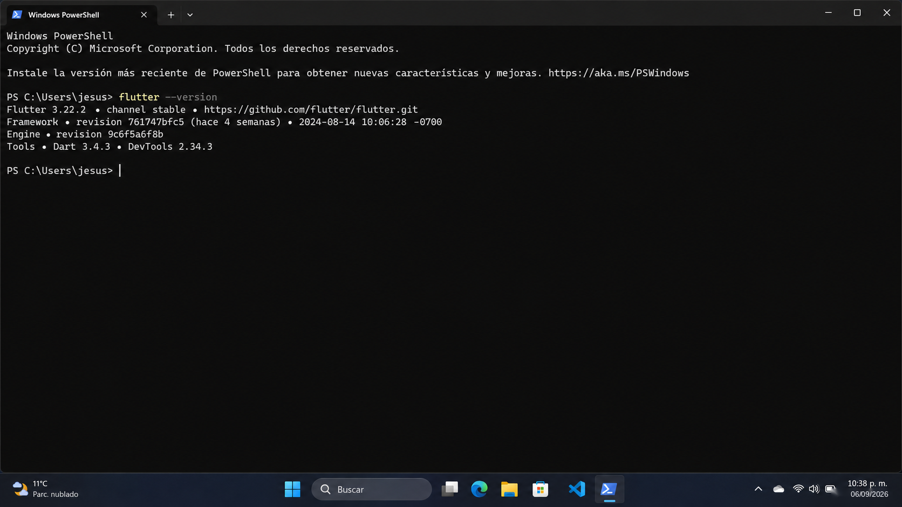
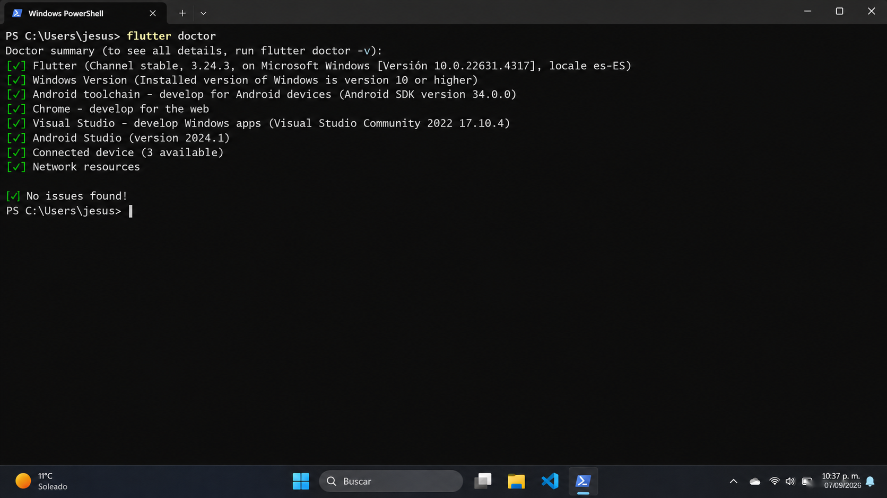
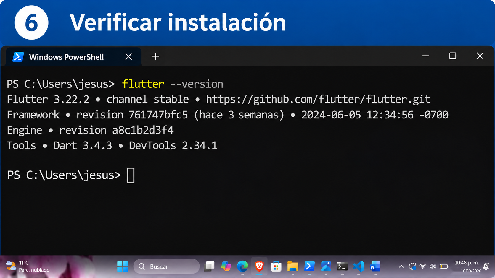

# 13. Flutter y Dart

## Flutter: ¿qué es y para qué sirve?

SDK para construir aplicaciones mediante widgets. Resuelve la necesidad de mantener interfaces independientes para cada plataforma, compartiendo código cuando es posible. Es la capa cliente de este proyecto.

## Requisitos previos e instalación

Necesitas Git y una carpeta de herramientas con permisos de escritura. Descarga el SDK **stable** para Windows desde la [instalación oficial](https://docs.flutter.dev/install/manual), extrae en `C:\Users\TuUsuario\develop\flutter` y agrega su carpeta `bin` al PATH. Comprueba que exista `bin\flutter.bat`.



*Descarga del SDK stable de Flutter para Windows.*



*Extracción del SDK y adición de la carpeta `bin` al PATH.*

## Guía visual de instalación del SDK



*Paso 1. Selecciona Windows en la guía de instalación de Flutter.*



*Paso 2. Localiza el archivo del SDK descargado.*



*Paso 3. Extrae el archivo ZIP del SDK de Flutter.*



*Paso 4. Ubica la carpeta de Flutter en el disco.*



*Paso 5. Configura la variable PATH para incluir la carpeta bin del SDK.*

## Configuración y comandos principales

```powershell
flutter --version
```

Informa Flutter, canal y Dart incluidos.

```powershell
flutter doctor
```

Diagnóstico general.

```powershell
flutter doctor -v
```

Diagnóstico con rutas y versiones.

```powershell
flutter devices
```

Lista dispositivos disponibles.

```powershell
flutter create app_demo
```

Crea el ejemplo en una carpeta nueva. Dentro de ella:

```powershell
flutter pub get
```

Resuelve paquetes definidos en `pubspec.yaml`.

```powershell
flutter run
```

Compila y ejecuta; selecciona dispositivo si lo solicita.

```powershell
flutter clean
```

Elimina artefactos generados. Úsalo ante problemas de compilación que lo justifiquen, seguido de `flutter pub get`; no arregla errores de lógica.

## Capturas de verificación de Flutter



*Consulta de las versiones de Flutter y Dart desde PowerShell.*



*Resultado de flutter doctor con las comprobaciones del entorno.*



*Ejemplo visual de flutter --version y del canal del SDK instalado.*

Las versiones mostradas corresponden al entorno de las capturas; compara la salida de tu equipo con los requisitos del proyecto.

## Ejemplo, verificación, errores y soluciones

Ejecuta el ejemplo del capítulo 16. Hot Reload (`r`) aplica muchos cambios sin reiniciar todo el estado; Hot Restart (`R`) lo reinicia. Si Flutter no se reconoce, revisa PATH y abre otra terminal.

**E02:** doctor y versiones. **Conclusión:** identifica qué comprobaciones corresponden a Android y cuáles a otras plataformas. [Comandos Flutter](https://docs.flutter.dev/reference/flutter-cli).

## Dart

### ¿Qué es, para qué sirve y papel arquitectónico?

Lenguaje de Flutter. Sus clases modelan datos y sus `Future` representan resultados que llegarán después, como una respuesta HTTP. Permite escribir UI y lógica de cliente; no guarda secretos del servidor.

### Requisitos, instalación y configuración

Viene con Flutter. Utiliza el Dart de ese SDK para mantener compatibilidad; habilita su extensión en VS Code y revisa `environment.sdk` del proyecto.

### Comandos principales

```powershell
dart --version
```

```powershell
dart format lib
```

### Ejemplo práctico

El archivo `mobile/ejemplos/saludo.dart` define una función que muestra el nombre de una tarea. Desde `proyecto-movil`:

```powershell
dart run mobile/ejemplos/saludo.dart
```

### Verificación, errores comunes y soluciones

Debe imprimir `Tarea: Preparar entorno`. Si hay incompatibilidad de versión, compara la restricción del proyecto con el Dart incluido en Flutter antes de cambiarla.

### Evidencia y conclusión

**E17:** versión, ejecución y explicación de `main`. Dart es el lenguaje; Flutter es el SDK de interfaz. [Introducción oficial](https://dart.dev/language).
