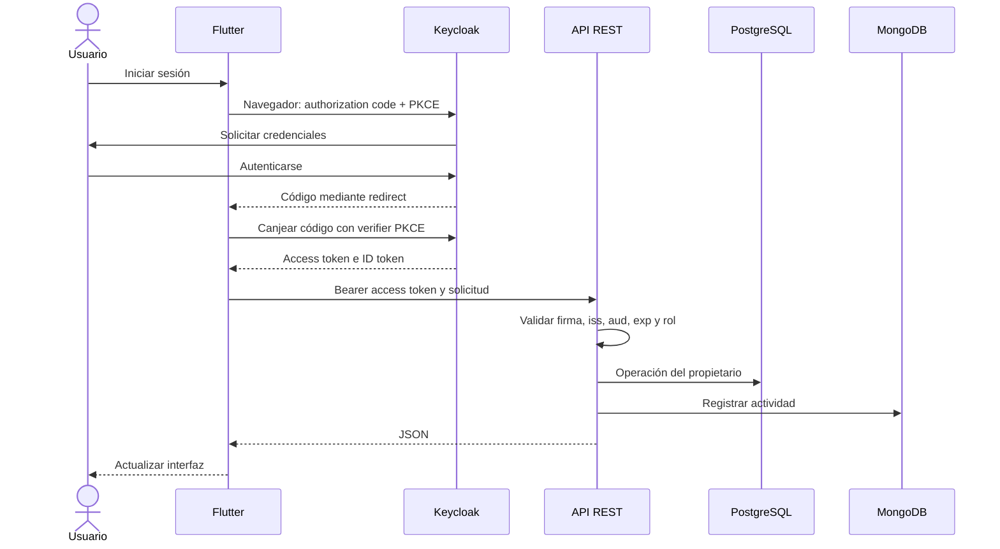

# 26. Flujo de autenticación



```http
Authorization: Bearer TOKEN
```

El access token autoriza acceso a la API. El ID token informa del inicio de sesión al cliente: no se usa en lugar del access token. PKCE vincula el código al cliente que inició el flujo, sin requerir un secreto incrustado en Flutter.

Cada petición se valida de forma independiente. El cliente oculta botones por comodidad, pero el backend sigue comprobando roles y propiedad. Una cuenta sin rol obtiene 403; una solicitud sin token obtiene 401; una tarea de otro propietario devuelve 404 para no revelar su existencia.

Cerrar sesión borra las credenciales locales e intenta finalizar la sesión del navegador en Keycloak. Un access token ya emitido puede ser válido hasta su expiración; la API no consulta revocación por cada solicitud en este laboratorio.
