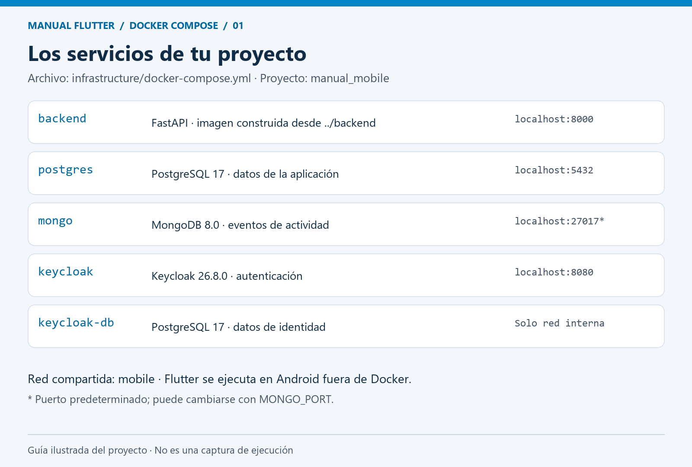
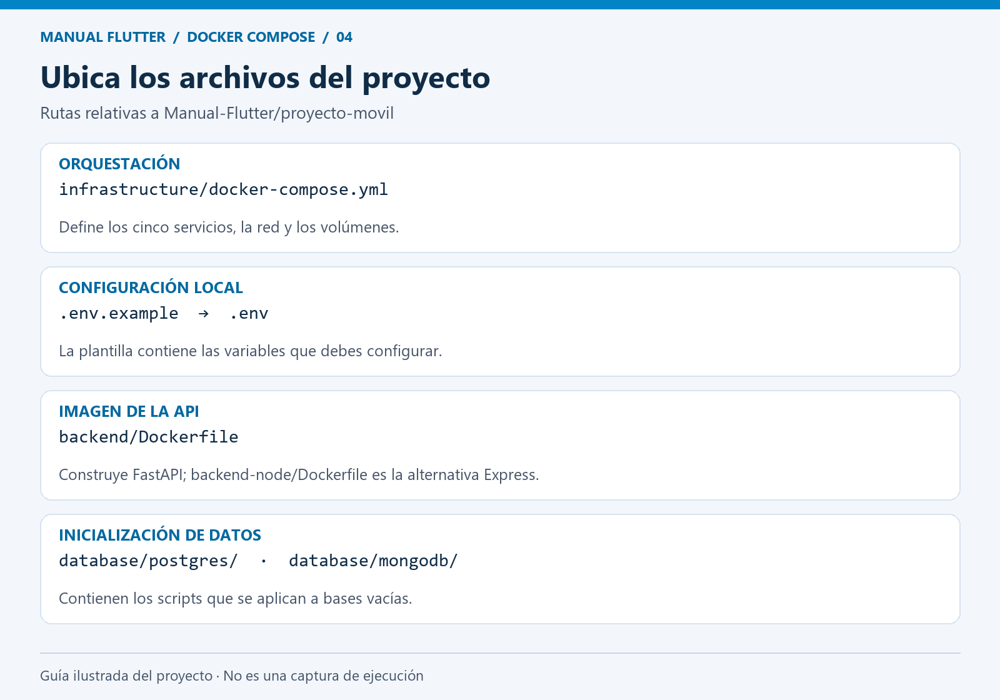
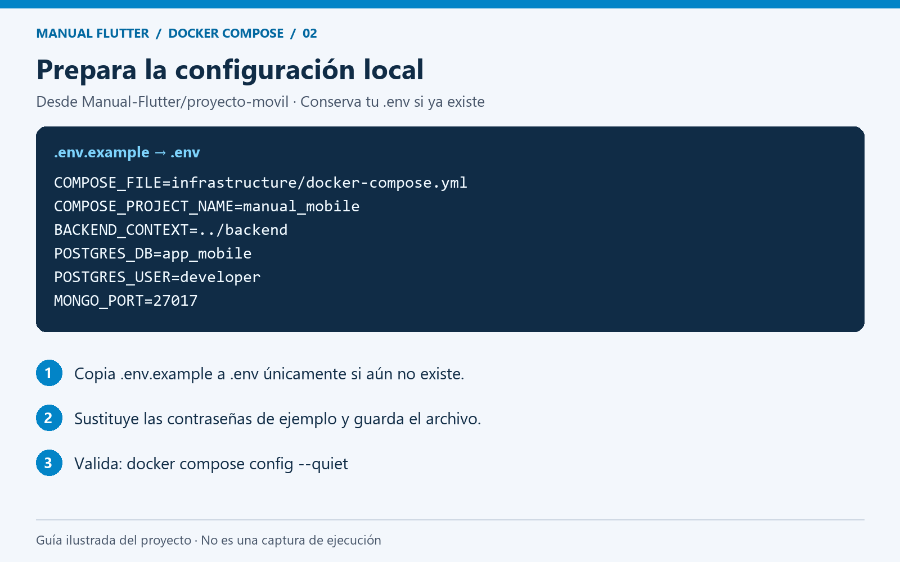
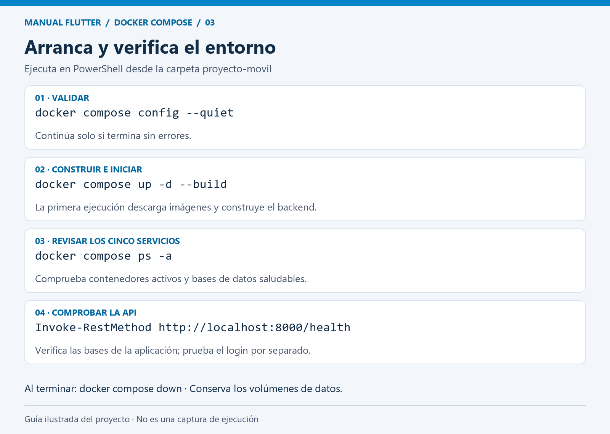
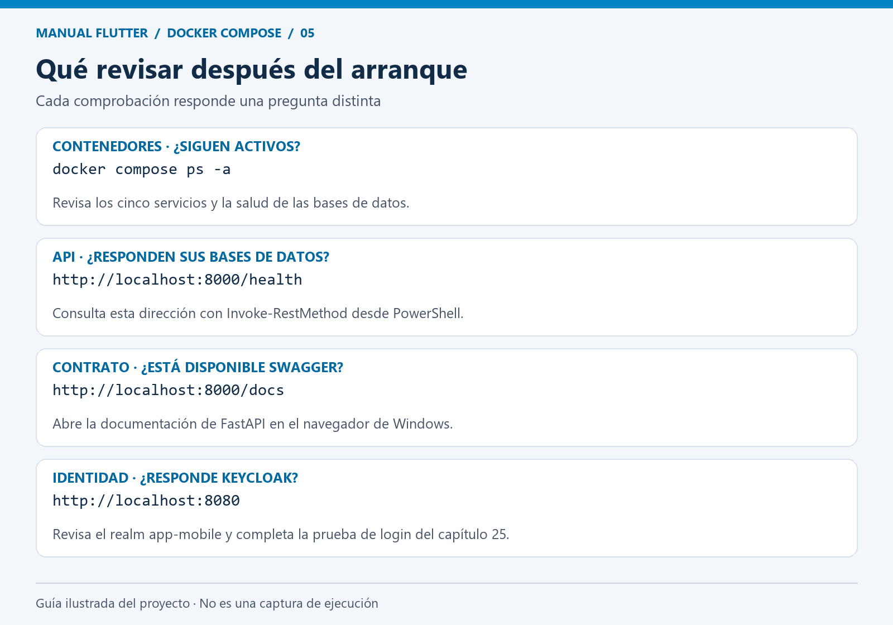
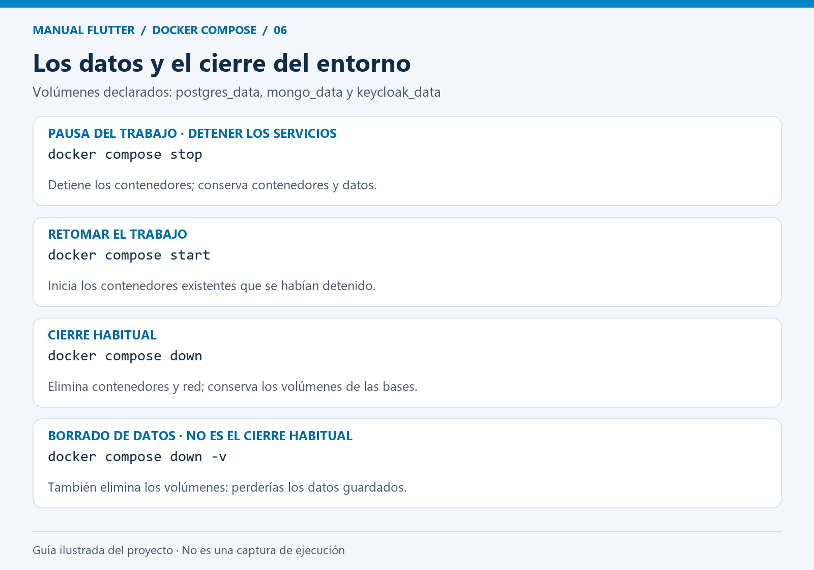
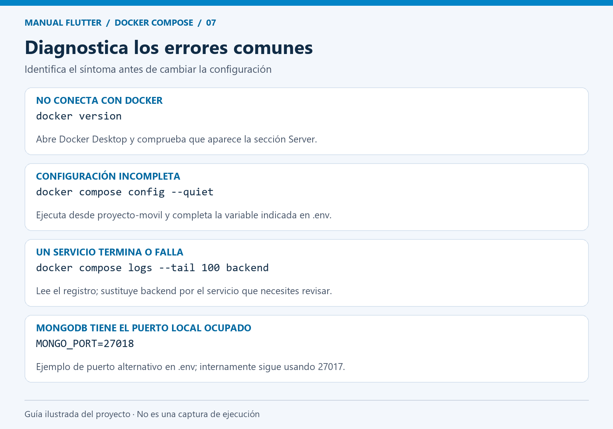

# 29. Docker Compose

## ¿Qué es, para qué sirve y papel arquitectónico?

Herramienta para describir varios contenedores como un sistema. Resuelve el arranque manual con numerosos comandos y redes inconsistentes.

## Requisitos e instalación

Docker Desktop incluye Compose v2. Comprueba:

```powershell
docker compose version
```

## Configuración

`infrastructure/docker-compose.yml` contiene backend, PostgreSQL, MongoDB, Keycloak y un PostgreSQL independiente para identidad. `services` define procesos; `volumes` preserva datos; `networks` permite comunicación por nombres; `environment` configura procesos; `ports` publica servicios al anfitrión.

Desde `proyecto-movil`, copia `.env.example` a `.env`, sustituye contraseñas y conserva `COMPOSE_FILE=infrastructure/docker-compose.yml`. Las rutas de montaje y build se resuelven respecto del archivo Compose; por eso usan `../backend` y `../database`.

## Comandos principales y ejemplo práctico

```powershell
docker compose config --quiet
```

Valida la configuración sin imprimir valores sensibles.

```powershell
docker compose up -d
```

```powershell
docker compose ps
```

```powershell
docker compose logs --tail 50 backend
```

```powershell
docker compose build
```

```powershell
docker compose down
```

Usa `up -d --build` después de cambiar código. Para Express modifica `BACKEND_CONTEXT` según README y reconstruye. Los healthchecks de las bases evitan iniciar el backend antes de que respondan; Keycloak puede tardar más. `/health` comprueba las dos bases, no sustituye la prueba del login.

## Verificación, errores comunes y soluciones

Si 8000 está ocupado, detén tu Uvicorn/Node local. Si hay un volumen antiguo, los scripts de inicialización no vuelven a correr. `down` conserva volúmenes; `down -v` borra datos y requiere asumir esa pérdida.

## Aplicación paso a paso en este proyecto

El archivo real es [docker-compose.yml](../../infrastructure/docker-compose.yml). Compose organiza los siguientes cinco servicios de la aplicación de tareas:

| Servicio | Origen | Función y acceso desde Windows |
| --- | --- | --- |
| `backend` | Construye `../backend/Dockerfile` por defecto | API FastAPI en `http://localhost:8000`; Swagger en `/docs` |
| `postgres` | `postgres:17` | Datos de la aplicación, puerto `5432` |
| `mongo` | `mongo:8.0` | Eventos de actividad, puerto `27017` por defecto |
| `keycloak-db` | `postgres:17` | Base de identidad; sin puerto publicado a Windows |
| `keycloak` | `quay.io/keycloak/keycloak:26.8.0` | Autenticación en `http://localhost:8080` |

Flutter se ejecuta en Android y consume la API; no hay un contenedor Flutter en este archivo. Los servicios comparten la red `mobile`: el backend encuentra las bases por los nombres `postgres` y `mongo`, y consulta las claves de autenticación en `keycloak:8080`. Dentro de un contenedor, `localhost` designa ese mismo contenedor.



*Figura 29.1. Guía ilustrada de los cinco servicios definidos en el proyecto; no representa una captura de ejecución.*

### 1. Preparar Docker y la carpeta de trabajo

Abre Docker Desktop y espera a que el motor de contenedores Linux esté listo. Desde la raíz del repositorio ejecuta en PowerShell:

```powershell
Set-Location .\Manual-Flutter\proyecto-movil
docker version
docker compose version
```

`docker version` debe mostrar Client y Server. Todos los comandos siguientes se ejecutan desde `proyecto-movil`.



*Figura 29.2. Archivos del proyecto que intervienen en la configuración, construcción e inicialización.*

### 2. Crear la configuración local

Este comando copia la plantilla únicamente si todavía no existe `.env`, para conservar una configuración previa:

```powershell
if (-not (Test-Path .env)) { Copy-Item .env.example .env }
notepad .env
```

La plantilla [`.env.example`](../../.env.example) ya contiene estas opciones:

```dotenv
COMPOSE_FILE=infrastructure/docker-compose.yml
COMPOSE_PROJECT_NAME=manual_mobile
BACKEND_CONTEXT=../backend
POSTGRES_DB=app_mobile
POSTGRES_USER=developer
MONGO_PORT=27017
```

Conserva las demás variables de la plantilla y sustituye los valores de `POSTGRES_PASSWORD`, `POSTGRES_ADMIN_PASSWORD`, `MONGO_PASSWORD`, `MONGO_ROOT_PASSWORD`, `KEYCLOAK_DB_PASSWORD` y `KEYCLOAK_ADMIN_PASSWORD` antes del primer arranque. Guarda `.env`; no lo incluyas en Git ni en capturas.

`COMPOSE_FILE` selecciona el archivo de infraestructura y `COMPOSE_PROJECT_NAME` agrupa los recursos como `manual_mobile`. Las rutas `../backend` y `../database` parten de la carpeta `infrastructure`. Compose lee las variables y el YAML pasa explícitamente al contenedor las que necesita mediante `environment`.



*Figura 29.3. Variables de la plantilla y pasos para preparar `.env`, sin mostrar contraseñas.*

### 3. Validar y arrancar

```powershell
docker compose config --quiet
docker compose config --services
docker compose up -d --build
docker compose ps -a
```

Continúa al arranque solo si la validación termina sin errores. `config --services` debe listar los cinco nombres de la tabla. `up -d --build` construye la imagen del backend, obtiene las imágenes necesarias y crea contenedores, red y volúmenes. La primera ejecución necesita acceso a Internet y puede tardar varios minutos.

Las bases de datos tienen `healthcheck`. El backend espera a que PostgreSQL y MongoDB estén saludables; Keycloak espera a su propia base. La condición `service_started` de Keycloak no garantiza que el login ya esté listo: revisa su registro antes de probar autenticación.



*Figura 29.4. Guía ilustrada de arranque y verificación; las salidas reales deben registrarse en la evidencia E12.*

### 4. Comprobar el resultado

```powershell
docker compose logs --tail 50 backend keycloak
Invoke-RestMethod -Uri http://localhost:8000/health
```

Comprueba que los cinco contenedores siguen activos y que las bases muestran `healthy`. Abre `http://localhost:8000/docs` para revisar la API FastAPI y `http://localhost:8080` para acceder a Keycloak. `/health` verifica las dos bases de la aplicación; el login se comprueba por separado siguiendo el [capítulo 25](25-keycloak.md).

Para conectar Flutter en un teléfono Android por USB, configura ADB y las URLs según el [README del proyecto](../../README.md) y el [capítulo 32](32-integracion-keycloak.md). Los puertos de este Compose se publican en `127.0.0.1`: el teléfono no puede acceder directamente mediante la IP de la computadora en la red Wi-Fi.



*Figura 29.5. Puntos de comprobación desde Windows. La guía no representa resultados de una ejecución real.*

### 5. Conservar datos y administrar los servicios

| Acción | Comando desde `proyecto-movil` |
| --- | --- |
| Consultar estado | `docker compose ps -a` |
| Seguir el registro del backend | `docker compose logs -f backend` (Ctrl+C termina la vista del registro) |
| Reconstruir después de editar el backend | `docker compose up -d --build backend` |
| Detener temporalmente | `docker compose stop` |
| Volver a iniciar contenedores detenidos | `docker compose start` |
| Eliminar contenedores y red al terminar | `docker compose down` |
| Volver a crear el entorno | `docker compose up -d --build` |

Los volúmenes `postgres_data`, `mongo_data` y `keycloak_data` conservan los datos al ejecutar `down`. Los archivos de `database` se montan para inicializar bases vacías; modificarlos no actualiza automáticamente una base ya creada. Cambiar las contraseñas en `.env` tampoco cambia por sí solo las contraseñas guardadas en esas bases. `docker compose down -v` elimina los volúmenes y sus datos: no forma parte del cierre habitual de esta práctica.

Para utilizar la alternativa Express, sigue el cambio de `BACKEND_CONTEXT=../backend-node` y reconstrucción descrito en el [README](../../README.md). El resto de servicios se mantiene y se utiliza un solo backend a la vez.



*Figura 29.6. Diferencias entre detener servicios, cerrar el entorno y eliminar datos persistentes.*

### Problemas específicos de este entorno

| Síntoma | Revisión y solución |
| --- | --- |
| No encuentra el archivo de configuración | Ejecuta desde `proyecto-movil` y comprueba que `.env` conserva `COMPOSE_FILE` |
| Solicita una variable obligatoria | Completa la variable indicada en `.env` y repite `config --quiet` |
| No conecta con el motor | Inicia Docker Desktop y confirma que `docker version` muestra Server |
| Puerto 8000, 5432 o 8080 ocupado | Identifica el servicio local que usa ese puerto y detenlo si corresponde antes de arrancar Compose |
| Puerto 27017 ocupado | Ajusta `MONGO_PORT` en `.env`; la conexión interna del backend sigue usando `mongo:27017` |
| Un servicio termina o queda no saludable | Consulta `docker compose ps -a` y `docker compose logs --tail 100 NOMBRE_SERVICIO` |
| La API responde pero el login falla | Revisa Keycloak, el realm `app-mobile`, los usuarios y las URLs del capítulo 32 |



*Figura 29.7. Guía de diagnóstico. El puerto 27018 es un ejemplo alternativo: comprueba que esté disponible y vuelve a ejecutar `docker compose up -d` para aplicar el cambio.*

## Evidencia y conclusión

Para la [evidencia E12](../evidence/E12.md), registra la versión de Compose, los cinco servicios, su estado y la respuesta real de `/health`. Añade capturas de Swagger y Keycloak cuando ambos respondan. No presentes estos resultados esperados como pruebas ejecutadas.

Referencias: [variables de Compose](https://docs.docker.com/compose/how-tos/environment-variables/envvars/), [comandos de Compose](https://docs.docker.com/reference/cli/docker/compose/) y [volúmenes](https://docs.docker.com/reference/compose-file/volumes/).

**E12:** servicios, health y arranque. Explica diferencia entre ordenar arranque y garantizar disponibilidad permanente. [Compose](https://docs.docker.com/compose/), [dependencias y salud](https://docs.docker.com/compose/how-tos/startup-order/).
