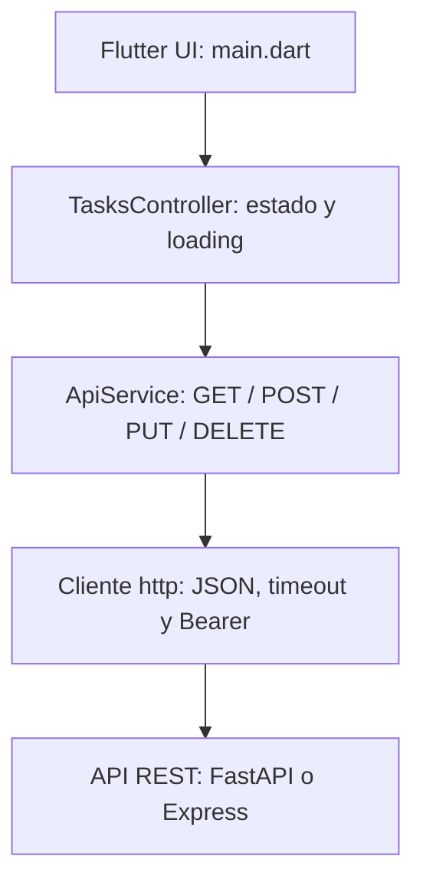

# 31. Integración Flutter y API



Cada capa tiene una responsabilidad. La UI presenta y recibe acciones; el controlador actualiza estado; el servicio realiza solicitudes. Se usa `ChangeNotifier` sin añadir otro administrador de estado para mantener visible el flujo.

## Archivos reales

| Archivo en `mobile/flutter_app` | Responsabilidad |
| --- | --- |
| `lib/main.dart` | Login, lista, formulario, confirmación y perfil |
| `lib/controllers/tasks_controller.dart` | `busy`, errores, carga y mutaciones |
| `lib/services/api_service.dart` | Cliente HTTP, códigos, JSON y timeout |
| `lib/models/task.dart` | Conversión de JSON a Task |
| `lib/config.dart` | URLs no secretas recibidas al compilar |

Desde esa carpeta:

```powershell
flutter pub get
```

El paquete `http` está declarado en `pubspec.yaml`. El servicio admite llamadas como las utilizadas por el controlador:

```dart
final values = await api.request('GET', '/tasks') as List;
```

```dart
await api.request('POST', '/tasks', body: {
  'title': 'Preparar demostración',
  'completed': false,
  'category_id': null,
});
```

Estas expresiones pertenecen a métodos del controlador; el programa completo está en los archivos señalados. `jsonEncode` serializa el cuerpo; `jsonDecode` convierte la respuesta. `await` espera el resultado sin bloquear toda la interfaz.

## Errores y carga

El indicador de carga aparece mientras `busy` es verdadero y deshabilita mutaciones simultáneas. La solicitud tiene timeout de 15 segundos. Un error de red, JSON inválido o estado HTTP fallido se convierte en un mensaje. Ante 401 el servicio intenta renovar el token una vez; no repite indefinidamente.

> **Nota:** si el servidor guardó una tarea y la conexión se cortó antes de recibir la respuesta, reintentar POST puede duplicarla. Consulta la lista antes de repetir; un sistema productivo puede agregar claves de idempotencia.

## Verificación y evidencia

**E14:** crear desde Flutter, comprobar la respuesta y verla en PostgreSQL. **E24:** pruebas del servicio HTTP. Prueba también la API apagada y confirma que aparece un error en lugar de una carga infinita. [Paquete http](https://pub.dev/packages/http).
