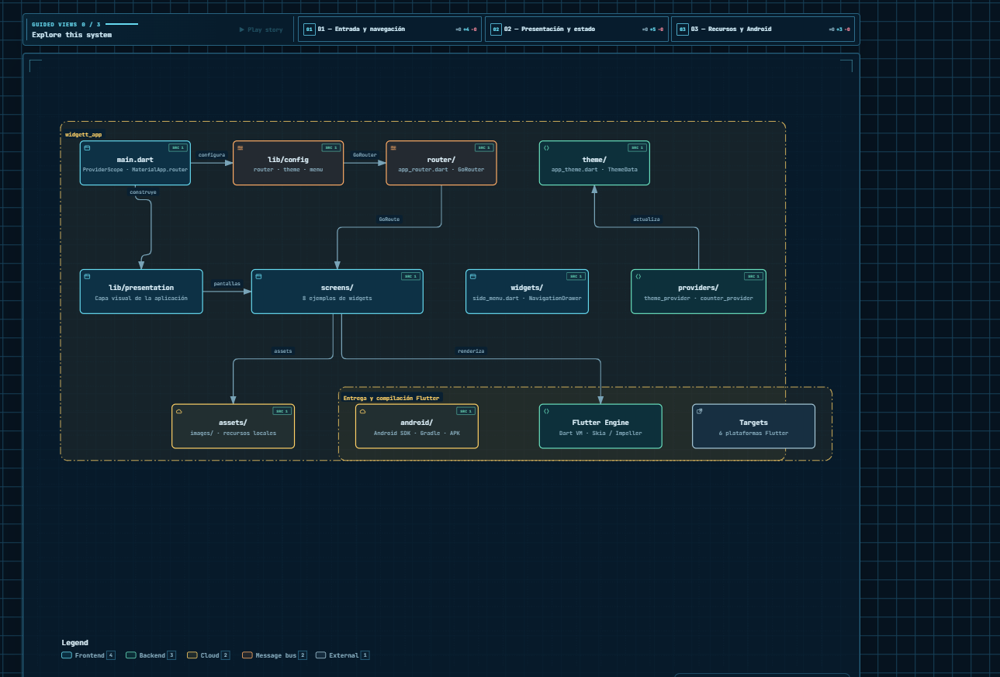
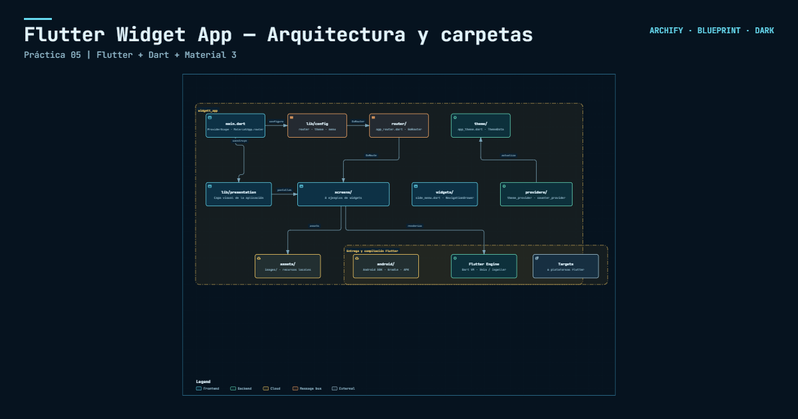

# Práctica 05 · Flutter Widget App

Aplicación educativa en Flutter para explorar widgets de Material Design 3. Incluye navegación, tema dinámico, gestión de estado, animaciones, controles interactivos y recursos locales.

## Sitio en GitHub Pages

La documentación y los diagramas interactivos de la práctica están disponibles en:

[Ver Práctica 05 en GitHub Pages](https://br1anj3sus3b.github.io/MDI-Brian-Jesus-230308/)

## Objetivo

Centralizar ejemplos funcionales de widgets comunes de Flutter en una aplicación móvil organizada por módulos. Cada pantalla permite probar un componente real, no una captura estática.

## Tecnologías

- Flutter y Dart `^3.13.3`
- Material Design 3
- GoRouter para rutas y navegación
- Riverpod para estado compartido de tema y contador
- `animate_do` para animaciones de interfaz
- Android SDK y Gradle para compilación Android

## Galería de ejemplos

| Pantalla | Qué demuestra |
| --- | --- |
| Home | Catálogo responsivo y `NavigationDrawer`. |
| Theme Changer | Color semilla, `ThemeData`, `ColorScheme` y modo oscuro. |
| Buttons | Botones Material 3, iconos y estados habilitado/deshabilitado. |
| Cards | Imágenes locales, `Card`, `ListTile` y elevaciones. |
| Progress Indicators | Indicadores circulares, lineales, determinados e indeterminados. |
| Snackbars & Dialogs | `ScaffoldMessenger`, `SnackBar` y `AlertDialog`. |
| Animated Container | Cambios animados de tamaño, color, bordes y forma. |
| Counter Screen | Estado numérico reactivo con Riverpod. |
| UI Controls | Switches, radios, casillas y listas expandibles. |
| Tutorial e Infinite Scroll | Paginación introductoria y carga incremental de contenido. |

## Ejecución

Desde `Practica05/widgett_app`:

```powershell
flutter pub get
flutter run
```

Para Android:

```powershell
flutter devices
flutter run -d <id-del-dispositivo>
```

## Verificación

```powershell
flutter analyze
flutter test
```

Las pruebas verifican que `MainApp` inicia correctamente y mantienen una captura golden de la pantalla principal.

## Rutas de la aplicación

Las rutas se configuran en `lib/config/router/app_router.dart` mediante GoRouter.

| Ruta | Pantalla |
| --- | --- |
| `/` | `HomeScreen` |
| `/theme-changer` | `ThemeChangerScreen` |
| `/buttons` | `ButtonsScreen` |
| `/cards` | `CardsScreen` |
| `/progress` | `ProgressScreen` |
| `/snackbars` | `SnackbarScreen` |
| `/animated-container` | `AnimatedScreen` |
| `/counter` | `CounterScreen` |
| `/ui-controls` | `UiControlsScreen` |
| `/tutorial` | `AppTutorialScreen` |
| `/infinite` | `InfiniteScrollScreen` |

El menú lateral reutilizable está en `lib/presentation/widgets/side_menu.dart`; el catálogo de opciones está en `lib/config/menu/menu_items.dart`.

## Arquitectura

El flujo principal es:

```text
Usuario
  → main.dart / ProviderScope
  → MaterialApp.router
  → GoRouter
  → HomeScreen y pantallas de demostración
  → Widgets Material 3 e interacciones
  → Riverpod o setState
  → reconstrucción de interfaz
```

### Capas y carpetas principales

```text
lib/
├── main.dart                         # Punto de entrada y ProviderScope
├── config/
│   ├── menu/                         # Elementos del catálogo y drawer
│   ├── router/                       # GoRouter y GoRoute
│   └── theme/                        # AppTheme, ThemeData y ColorScheme
└── presentation/
    ├── providers/                    # Estado de tema y contador
    ├── screens/                      # Pantallas de demostración
    └── widgets/                      # SideMenu y componentes reutilizables

assets/
└── images/                           # Ilustraciones y recursos locales

android/                              # Gradle, Android SDK y empaquetado APK
```

### Estado y actualización de interfaz

- `themeNotifierProvider` conserva el color elegido y el modo claro/oscuro durante la navegación.
- `counterProvider` mantiene el contador compartido.
- Los controles locales, el progreso y `AnimatedContainer` usan estado de widget y callbacks para reconstruir sólo la interfaz necesaria.
- `AppTheme` crea el `ThemeData` a partir de `ColorScheme.fromSeed`.

### Recursos y renderizado

Los recursos declarados en `pubspec.yaml` se almacenan en `assets/images/`. Las tarjetas cargan imágenes locales con `Image.asset`; las pantallas de ejemplo también pueden mostrar contenido de red con manejo de carga y error. Flutter entrega los widgets al motor de renderizado Dart/Skia o Impeller y Gradle empaqueta el resultado Android.

## Documentación visual de arquitectura

El panel incluye zoom, desplazamiento, búsqueda, foco de nodos, trazado de relaciones, vistas guiadas, presentación y exportación.

- [Panel de arquitectura](docs/architecture/04-widget-app-folders-readable.html)
- [Panel con carpetas principales](docs/architecture/03-widget-app-folders.html)
- [Panel técnico del sistema](docs/architecture/02-widget-app-panel.html)





## Capturas de referencia

| Captura 01 | Captura 02 | Captura 03 |
| --- | --- | --- |
|  |  |  |
|  |  |  |
|  |  |  |
|  |  |  |
|  |  |  |
|  |  |  |
|  | &mdash; | &mdash; |


## Compilación Android

```powershell
flutter build apk
```

El flujo de entrega es Flutter Framework → Android SDK → Gradle → APK → dispositivo Android. El proyecto también contiene los runners generados para iOS, web, Windows, macOS y Linux.

## Mantenimiento

Para añadir un ejemplo:

1. Crea la pantalla dentro de `lib/presentation/screens/`.
2. Expórtala desde `screens.dart`.
3. Registra su `GoRoute` en `app_router.dart`.
4. Agrega el `MenuItem` correspondiente.
5. Añade pruebas y actualiza la captura golden cuando cambie la pantalla principal.
