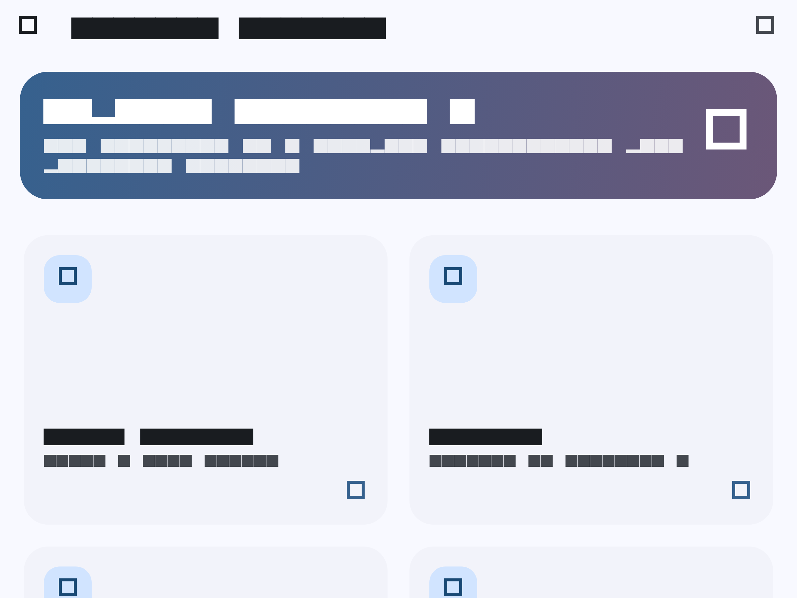

# Práctica 05 · Widgets App

Aplicación Flutter de práctica para explorar widgets de Material 3, navegación entre pantallas, animaciones y manejo de estado con Riverpod.

## Objetivo

Centralizar ejemplos interactivos de widgets comunes de Flutter en una sola aplicación. La pantalla principal presenta el catálogo de ejercicios y el menú lateral permite navegar entre ellos.

## Contenido

| Módulo | Qué demuestra |
| --- | --- |
| Riverpod Counter | Estado reactivo mediante un proveedor de contador. |
| Botones | Variantes de botones de Material. |
| Tarjetas | Contenedores y estilos de tarjetas. |
| Progress Indicators | Indicadores lineales y circulares, incluidos controles manuales. |
| Snackbars y diálogos | Mensajes temporales, diálogos y confirmaciones. |
| Animated Container | Transiciones implícitas de tamaño, color y bordes. |
| UI Controls | Interruptores, radios, casillas y listas expandibles. |
| Tutorial | Recorrido paginado de introducción a la aplicación. |
| Infinite Scroll | Carga incremental y actualización mediante arrastre. |
| Cambiar tema | Modo oscuro y selección dinámica del color semilla. |

## Tecnologías

- Flutter y Dart (SDK `^3.13.3`)
- Material 3
- [GoRouter](https://pub.dev/packages/go_router) para las rutas
- [Riverpod](https://pub.dev/packages/flutter_riverpod) para el estado del contador y tema
- [animate_do](https://pub.dev/packages/animate_do) para animaciones de interfaz

## Estructura

```text
lib/
├── config/
│   ├── menu/          # Elementos del catálogo y menú lateral
│   ├── router/        # Rutas de GoRouter
│   └── theme/         # Tema Material y paleta de colores
├── presentation/
│   ├── providers/     # Estado de contador y tema
│   ├── screens/       # Pantallas de cada ejercicio
│   └── widgets/       # Componentes reutilizables, como SideMenu
└── main.dart          # ProviderScope y MaterialApp.router
```

## Captura de la aplicación

Pantalla principal con el catálogo de ejercicios disponibles:



## Recursos visuales

La ilustración principal forma parte de los recursos locales de la aplicación y se incluye también aquí como referencia visual. Está almacenada en `assets/images/widgets-learning-hero.png`, por lo que funciona sin depender de una conexión externa.


## Ejecutar el proyecto

Desde esta carpeta:

```powershell
flutter pub get
flutter run
```

Para seleccionar un destino concreto:

```powershell
flutter devices
flutter run -d windows
```

## Verificación

```powershell
flutter analyze
flutter test
```

La prueba de widgets en `test/widget_test.dart` comprueba que `MainApp` inicia y muestra la pantalla principal.

## Navegación

Las rutas se declaran en `lib/config/router/app_router.dart`. La pantalla inicial es `/`; el menú principal y el cajón lateral se alimentan de `lib/config/menu/menu_items.dart`. Para añadir un ejercicio nuevo, crea su pantalla, expórtala desde `screens.dart`, registra la ruta y agrega un `MenuItem`.

## Observaciones de revisión

- El proyecto tiene una estructura clara por presentación y configuración, adecuada para una práctica de UI.
- El estado transversal se limita correctamente a Riverpod: contador y tema.
- Actualmente dispone de una prueba de humo. Conviene añadir pruebas de navegación y de los proveedores si se amplía la aplicación.
