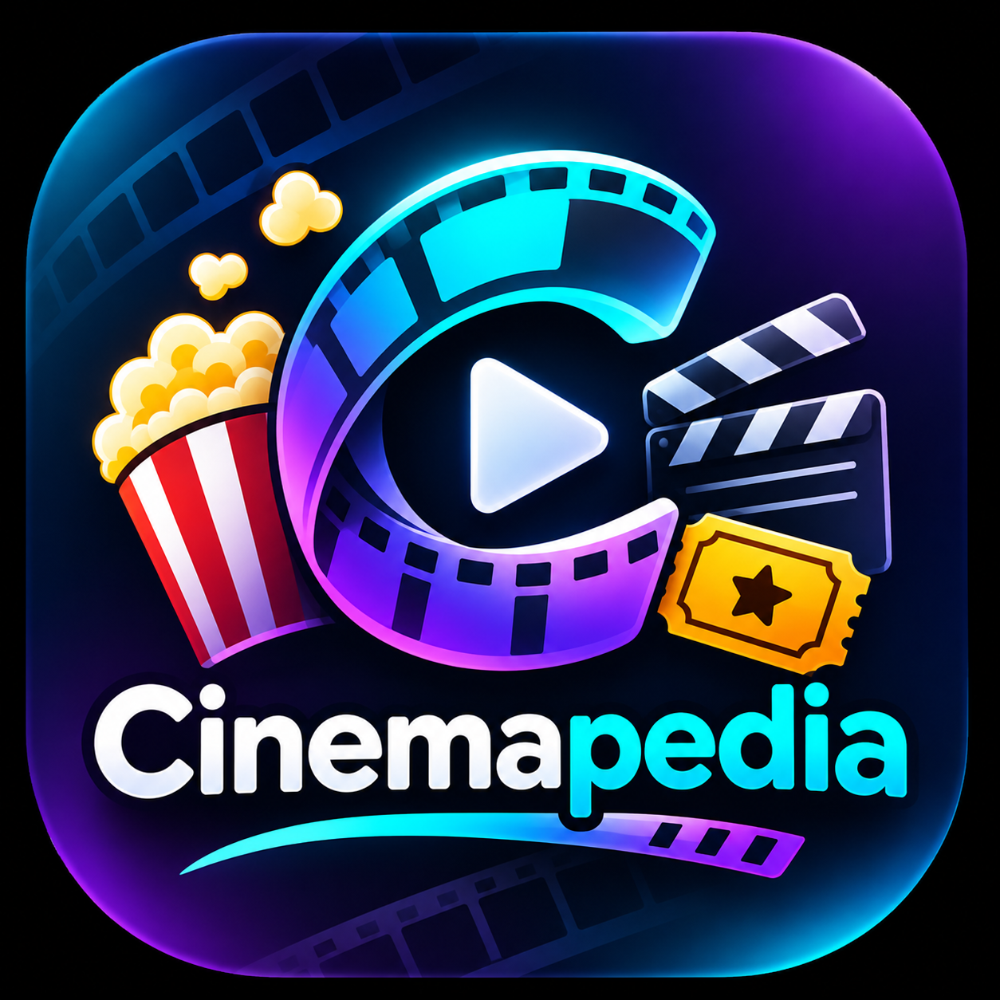
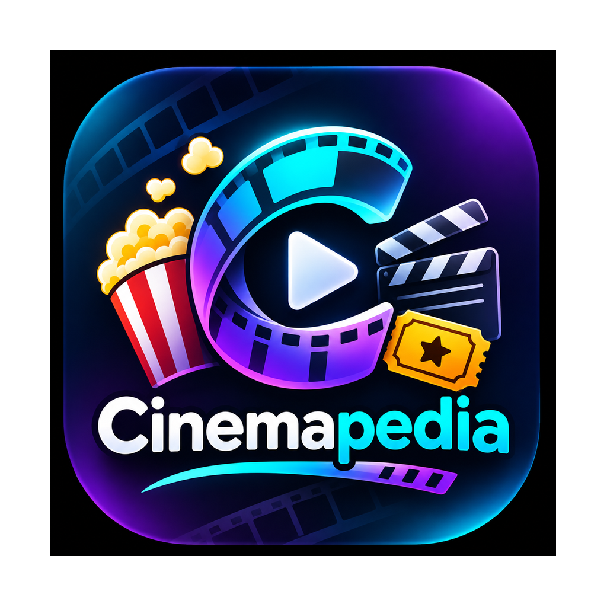

# Cinemapedia — Práctica 06

<p align="center">
  
</p>

Aplicación desarrollada con **Flutter y Dart** para explorar películas de **The Movie Database (TMDB)**. Combina un diseño cinematográfico oscuro con catálogos regionales, búsqueda, favoritos persistentes y un carrusel interactivo.

## Funcionalidades

- **Inicio:** carrusel de películas destacadas y listas horizontales con acceso a las colecciones completas.
- **Categorías:** películas en cines, próximos estrenos, populares y mejor calificadas, con carga paginada.
- **Búsqueda:** consulta de películas por título y acceso a su ficha.
- **Detalles:** título, imágenes, sinopsis, calificación, información de estreno y reparto, según los datos disponibles en TMDB.
- **Favoritos:** permite agregar y quitar películas desde los controles de corazón; la selección se guarda localmente con `SharedPreferences`.
- **Navegación:** menú lateral, barra inferior y navegación lateral para pantallas amplias.
- **Configuración regional:** selección de país e idioma de consulta, conservada entre sesiones.
- **Presentación:** fondos oscuros, acentos cian y violeta, tarjetas con pósteres y estados de carga.

### Controles del carrusel

| Acción | Resultado |
| --- | --- |
| Un toque en la zona izquierda de navegación | Retrocede una película. |
| Un toque en la zona derecha de navegación | Avanza una película. |
| Dos toques rápidos en el área de navegación | Regresa a la primera película sin ejecutar antes el toque simple. |
| Deslizamiento horizontal | Cambia de película manualmente. |
| Botón de corazón | Agrega o quita la película de favoritos. |
| Ver detalles | Abre la ficha de la película. |

El widget `MoviesSlideshow` utiliza un `PageView` con un único `PageController`. Las transiciones por toque duran **380 ms** y los indicadores se sincronizan mediante `onPageChanged`. Las flechas son circulares, semitransparentes y tienen un área de 48 × 48 píxeles lógicos.

Los botones respetan los extremos de la lista: retroceder desde la primera película o avanzar desde la última mantiene la posición. Se evitan animaciones programáticas simultáneas y se conserva el soporte de deslizamiento táctil, mouse y trackpad. Los controles informativos y de acción tienen sus propios espacios de interacción.

### Países disponibles

| País | Idioma de consulta | Código |
| --- | --- | --- |
| México (predeterminado) | Español | `es-MX` |
| Estados Unidos | Inglés | `en-US` |
| Alemania | Alemán | `de-DE` |
| Japón | Japonés | `ja-JP` |
| China | Chino simplificado | `zh-CN` |
| Rusia | Ruso | `ru-RU` |
| Brasil | Portugués | `pt-BR` |

La región determina los parámetros de consulta y la clasificación por edad solicitada. Los títulos, traducciones, imágenes y fechas dependen de la información disponible en TMDB; si no hay una clasificación regional, se muestra **«Sin clasificación disponible»**. La selección regional cambia los datos consultados, mientras que los controles de la interfaz permanecen en español.

## Tecnologías

| Herramienta | Uso |
| --- | --- |
| Flutter / Dart | Interfaz y lógica de la aplicación. |
| Flutter Riverpod | Estado, proveedores y actualización de datos. |
| Dio | Peticiones HTTP a TMDB. |
| GoRouter | Rutas y navegación entre pantallas. |
| SharedPreferences | Persistencia de favoritos y región. |
| Flutter Dotenv | Lectura de la configuración de entorno. |
| Intl | Formato de números. |
| Flutter Launcher Icons | Generación de iconos de la aplicación. |

## Estructura del proyecto

```text
cinemapedia_brian/
├── Assets/                  # Capturas e identidad visual
│   └── icon/                # Icono y capa de primer plano
├── lib/
│   ├── config/              # Entorno, formatos, regiones, rutas y tema
│   ├── domain/              # Entidades y contratos de datos/repositorios
│   ├── infrastructure/      # Acceso a TMDB, modelos, mapeadores y repositorios
│   ├── presentation/
│   │   ├── delegates/       # Búsqueda de películas
│   │   ├── providers/       # Películas, actores, favoritos y región
│   │   ├── screens/         # Inicio, detalles, colecciones y configuración
│   │   └── widgets/         # Carrusel, tarjetas y componentes compartidos
│   └── main.dart            # Punto de entrada
├── test/                    # Pruebas de datos, región y carrusel
├── android/                 # Proyecto nativo Android
├── ios/                     # Proyecto nativo iOS
├── linux/                   # Configuración Linux
├── macos/                   # Configuración macOS
├── web/                     # Configuración web
├── windows/                 # Configuración Windows
├── .env.template            # Plantilla de configuración
└── pubspec.yaml             # Dependencias y recursos Flutter
```

El flujo de datos sigue la separación **presentación → repositorios → fuentes de datos**, utilizando las entidades y contratos definidos en `domain`.

## Instalación y ejecución

### Requisitos

- Flutter con Dart compatible con `pubspec.lock`: las dependencias resueltas requieren **Flutter 3.44.0 o superior y Dart 3.13.0 o superior**.
- Un dispositivo o emulador configurado para Flutter.
- Una clave API de [TMDB](https://www.themoviedb.org/settings/api) y conexión a Internet para consultar el catálogo.

### Pasos

1. Abre una terminal en `Practica06/cinemapedia_brian`.
2. Copia `.env.template` como `.env` y completa la variable:

   ```dotenv
   THE_MOVIEDB_KEY=tu_clave_api_de_tmdb
   ```

   Mantén la clave real en el archivo local `.env`, fuera del historial de Git.

3. Instala las dependencias:

   ```bash
   flutter pub get
   ```

4. Consulta los dispositivos y ejecuta la aplicación:

   ```bash
   flutter devices
   flutter run
   ```

## Verificación

Desde la carpeta del proyecto:

```bash
dart format .
flutter analyze
flutter test
```

Las pruebas cubren la serialización de películas, el formato de calificaciones, la selección y persistencia regional, los parámetros enviados a TMDB y las clasificaciones por país. Las pruebas de widgets del carrusel comprueban toques simples, doble toque, límites, indicadores, arrastre táctil y con mouse, favoritos, lista vacía y reducción del número de películas.

Para ejecutar únicamente las pruebas del carrusel:

```bash
flutter test test/movies_slideshow_test.dart
```

## Galería de la aplicación

Capturas almacenadas en `Assets`, tomadas en Android. Muestran diferentes regiones y momentos del desarrollo; los catálogos y calificaciones corresponden al momento de la captura.

### Inicio y navegación del carrusel

| Inicio en español con flechas | Inicio en chino y favoritos | Catálogo en inglés |
| :---: | :---: | :---: |
|  |  |  |

### Categorías y colecciones

| Categorías | En cines | Populares |
| :---: | :---: | :---: |
|  |  |  |

### Exploración horizontal del catálogo regional

| Cartelera regional | Desplazamiento de tarjetas | Más películas |
| :---: | :---: | :---: |
|  |  |  |

### Instalación y vista previa del diseño

| Icono instalado en Android | Inicio antes de incorporar las flechas |
| :---: | :---: |
|  |  |

### Recursos gráficos

| Diseño neón | Capa de primer plano del icono |
| :---: | :---: |
|  |  |

Las rutas de las imágenes son relativas a este README y respetan el nombre de la carpeta `Assets`, incluyendo su mayúscula inicial.
