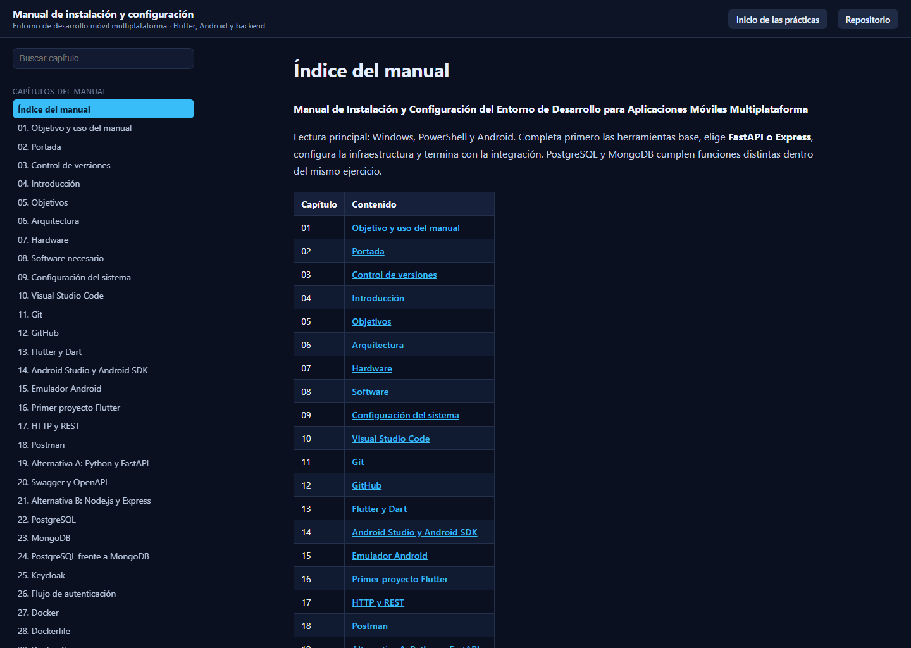

# 📱 Prácticas de la Asignatura de Desarrollo Móvil Integral

## 🎓 Ingeniería en Desarrollo y Gestión de Software


---

## 📚 Descripción

Repositorio correspondiente a las prácticas realizadas en la asignatura de **Desarrollo Móvil Integral**, perteneciente a la carrera de **Ingeniería en Desarrollo y Gestión de Software**.

En este repositorio se documentan las diferentes actividades, prácticas y aplicaciones desarrolladas durante el curso, utilizando principalmente el framework **Flutter** y el lenguaje de programación **Dart**.

El objetivo es aplicar los fundamentos del desarrollo de aplicaciones móviles, comprender la estructura de proyectos Flutter y utilizar herramientas de control de versiones para documentar y administrar el desarrollo de cada práctica.

---

## 👨‍💻 Datos del estudiante

| Dato | Información |
| --- | --- |
| 👤 **Nombre** | Brian Jesús Mendoza Márquez |
| 🎓 **Carrera** | Ingeniería en Desarrollo y Gestión de Software |
| 🆔 **Matrícula** | 230308 |
| 👥 **Grado y Grupo** | 10A |
| 📚 **Asignatura** | Desarrollo Móvil Integral |
| 👨‍🏫 **Docente** | M.T.I. Marco A. Ramírez Hernández |
| 📅 **Periodo** | Septiembre - Diciembre 2026 |

---

## 📝 Prácticas

| No. | Práctica | Potenciador | Estatus |
| --- | --- | --- | --- |
| 1 | Metodología | 5 | Concluida |
| 2 | Mi primera aplicación móvil con Flutter | 20 | Concluida |
| 3 | Hola Jarvis (Chat con Flutter) | 20 | Concluida |
| 4 | Toktik - Consumo de Videos con Flutter | 30 | Concluida |
| Unidad 1 | Manual de instalación de Flutter desde cero | 10 | Concluida |
| 5 | Práctica 05 - Widgets App | 40 | Concluida |

### Detalle de las prácticas

1. 📖 **Metodología** — Transcribir y comprender la metodología de trabajo y las fechas de evaluación de la asignatura.
2. 📱 [**Mi primera aplicación móvil con Flutter**](brian_mdi_230308/docs/) — Desarrollar una aplicación móvil utilizando Flutter, aplicando conceptos de `StatefulWidget` y `StatelessWidget`.
3. 💬 [**Hola Jarvis (Chat con Flutter)**](https://github.com/BR1ANJ3Sus3B/MDI-Brian-Jesus-230308/blob/main/Practica03/practica03_brianjesus_230308/README.md) — Desarrollar una aplicación de chat con Flutter y generar diagramas de arquitectura con Archify.
4. 🎬 [**Toktik - Consumo de Videos con Flutter**](Practica04-Brian/Toktik/) — Desarrollar una aplicación móvil de videos cortos con Flutter, integrando videos locales y contenido mediante las APIs de TikTok, Instagram y Facebook. Incluye feed vertical, reproducción de videos y arquitectura de datos. [🌐 Ver diagrama interactivo](https://br1anj3sus3b.github.io/MDI-Brian-Jesus-230308/Practica04-Brian/Toktik/docs/architecture/toktik-arquitectura.html).
5. 📖 [**Manual de instalación y configuración de Flutter desde cero**](Manual-Flutter/README.md) — Elaborar un manual paso a paso para instalar y configurar Flutter en Windows, incluyendo Android Studio, Visual Studio Code, SDK de Android, variables de entorno y configuración de dispositivos Android. [📄 Descargar manual en PDF](https://github.com/BR1ANJ3Sus3B/MDI-Brian-Jesus-230308/raw/refs/heads/main/Manual-Flutter/Manual-Flutter.pdf).
6. 🧩 [**Práctica 05 - Widgets App**](Practica05/widgett_app/README.md) — Desarrollar una aplicación móvil denominada Widgets App utilizando Flutter y Dart, que permita explorar e implementar componentes visuales e interactivos de Material Design 3 mediante pantallas demostrativas y un sistema de navegación.

---

## 🛠️ Tecnologías utilizadas

| Tecnología | Descripción |
| --- | --- |
| 💙 **Flutter** | Framework utilizado para el desarrollo de aplicaciones multiplataforma. |
| 🎯 **Dart** | Lenguaje de programación utilizado por Flutter. |
| 🌿 **Git** | Sistema de control de versiones utilizado para administrar los cambios del proyecto. |
| 🐙 **GitHub** | Plataforma utilizada para alojar, administrar y documentar el código fuente. |
| 💻 **Visual Studio Code** | Editor utilizado para el desarrollo de las aplicaciones. |

---

## 📂 Estructura del repositorio

```text
MDI-Brian-Jesus-230308/
├── 📄 index.html                         Portada de GitHub Pages
├── 📄 .nojekyll                          Desactiva el procesamiento de Jekyll
├── 📁 brian_mdi_230308/                  Práctica 02 · Contador en Flutter
│   ├── 📱 lib/
│   ├── 📄 pubspec.yaml
│   └── 📁 docs/                          Documentación y diagramas
├── 📁 Practica03/
│   └── 📁 practica03_brianjesus_230308/  Práctica 03 · Hola Jarvis
│       ├── 📱 lib/
│       ├── 🖼️ assets/                    Imágenes y GIF de reacción
│       ├── 📁 test/                      Pruebas
│       ├── 📄 pubspec.yaml
│       └── 📁 docs/                      Documentación y diagramas
├── 📁 Practica04-Brian/Toktik/           Práctica 04 · Toktik
├── 📁 Practica05/widgett_app/            Práctica 05 · Widgets App
│   ├── 📱 lib/
│   ├── 🖼️ Assets/
│   ├── 📄 pubspec.yaml
│   └── 📁 docs/                          Documentación y diagramas
└── 📁 Manual-Flutter/                    Unidad 1 · Manual de instalación
```

---

## 📱 Proyecto Flutter

Las aplicaciones desarrolladas en las prácticas utilizan **Flutter** para crear interfaces multiplataforma. Entre los conceptos trabajados se encuentran widgets, `StatelessWidget`, `StatefulWidget`, `MaterialApp`, `Scaffold`, `AppBar`, `Column`, `Row`, `Center`, `Text`, `FloatingActionButton`, manejo básico del estado, navegación, organización de pantallas y estructura de proyectos Flutter.

---

## 🚀 Ejecución del proyecto

Para ejecutar cualquiera de los proyectos Flutter, es necesario contar con Flutter instalado y configurado.

### 1. Clonar el repositorio

```bash
git clone https://github.com/BR1ANJ3Sus3B/MDI-Brian-Jesus-230308.git
cd MDI-Brian-Jesus-230308
```

### 2. Entrar a una práctica

Cada práctica es un proyecto Flutter independiente:

```bash
# Práctica 02 · Contador
cd brian_mdi_230308

# Práctica 03 · Hola Jarvis
cd Practica03/practica03_brianjesus_230308

# Práctica 04 · Toktik
cd Practica04-Brian/Toktik

# Práctica 05 · Widgets App
cd Practica05/widgett_app
```

### 3. Instalar dependencias y ejecutar

```bash
flutter pub get
flutter devices
flutter run
```

También es posible ejecutar el proyecto en un dispositivo específico:

```bash
flutter run -d windows
# o
flutter run -d edge
```

---

## 📸 Evidencias

### Práctica 01 — Metodología

📖 Documentación de la metodología y actividades de la asignatura.

### Práctica 02 — Mi primera aplicación móvil con Flutter

📱 Aplicación desarrollada utilizando Flutter y Dart.

### Práctica 03 — Hola Jarvis

💬 Chat en Flutter con un asistente simulado que responde tras 1.5 s con un texto aleatorio y un GIF de reacción, documentado con diagramas de arquitectura.

### Práctica 04 — Toktik

🎬 Aplicación móvil de videos cortos con un feed vertical, reproducción de videos y arquitectura de datos.

### Práctica 05 — Widgets App

🧩 Galería de componentes de Material Design 3 con navegación, tema dinámico, controles interactivos, animaciones y recursos locales. Consulta la [documentación de la práctica](Practica05/widgett_app/README.md).

### Manual de instalación publicado en GitHub Pages

📘 Manual de 41 capítulos con la instalación desde cero de Windows, Android Studio, Visual Studio Code y dispositivos Android, incluido el proyecto integrador y su verificación.

[Ver el manual en línea](https://br1anj3sus3b.github.io/MDI-Brian-Jesus-230308/Manual-Flutter/proyecto-movil/docs/)



---

## 🎯 Objetivos

- 📱 Aprender los fundamentos del desarrollo móvil.
- 💙 Comprender el funcionamiento de Flutter.
- 🎯 Aplicar los fundamentos del lenguaje Dart.
- 🧩 Crear interfaces utilizando widgets.
- 🔄 Comprender el manejo básico del estado.
- 🌿 Utilizar Git para controlar versiones.
- 🐙 Gestionar proyectos mediante GitHub.
- 📚 Documentar correctamente las prácticas realizadas.
- 🚀 Desarrollar progresivamente aplicaciones móviles.

---

## 📈 Progreso de la asignatura

```text
Práctica 01  ████████████████████ 100% ✅
Práctica 02  ████████████████████ 100% ✅
Práctica 03  ████████████████████ 100% ✅
Práctica 04  ████████████████████ 100% ✅
Práctica 05  ████████████████████ 100% ✅
```

---

## 📚 Aprendizaje

Este repositorio representa el avance del aprendizaje en **Desarrollo Móvil Integral**, desde los conceptos básicos de Flutter y Dart hasta la construcción de aplicaciones móviles más completas. Cada práctica tiene como propósito reforzar los conocimientos adquiridos y documentar el proceso de desarrollo.

---

## 👨‍💻 Autor

- **Brian Jesús Mendoza Márquez**
- 🎓 Ingeniería en Desarrollo y Gestión de Software
- 🆔 Matrícula: **230308**
- 📱 Desarrollo Móvil Integral
